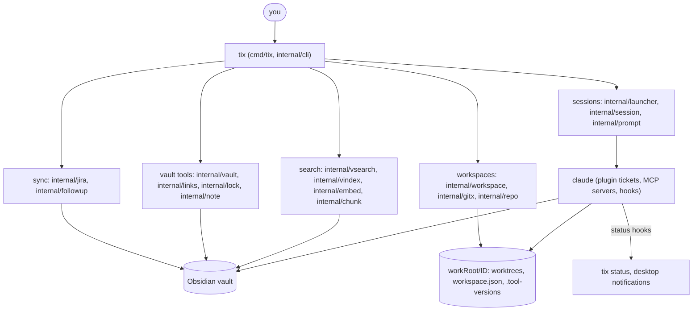

# Architecture

tix is one Go binary, `tix`, plus an Obsidian vault the agents use as long-term
memory. `tix` prepares workspaces and launches Claude Code sessions; the sessions do the
work, following the plugin's skills. Everything the plugin and the vault scaffold need is
embedded in `tix` (`assets/`); the plugin is unpacked to the cache on first use.

## Packages

| Package | Role |
|---|---|
| `internal/cli` | the cobra commands: `start`, `status`, `ws`, `vault`, `spec`, `ticket`, `teach`, `clean`, `sync`, `layout`, `claude`, `hook` |
| `internal/workspace` | a ticket workspace: `workspace.json` (repos, bases, branches, target versions), the tidy mark, the live sessions, the `.tool-versions` stamp |
| `internal/gitx`, `internal/repo` | git helpers (worktrees, unpushed commits), the config allowlist that every git call passes ([git hardening](git-hardening.md)), and the repo slug rules |
| `internal/spec`, `internal/ticketconv` | the spec parser, diff and vault versions ([spec workflow](spec-workflow.md), [versions](spec-versions.md)); manual-to-synced ticket conversion |
| `internal/diffcheck` | `tix ws diff-check`: binary, large, vault-ID and spec-ID checks of a commit range |
| `internal/vault`, `internal/config` | finding the current vault, its `.workflow.json`, tool versions |
| `internal/links`, `internal/lock`, `internal/vaultlock` | moving notes without breaking wikilinks, and the vault lock `/tix:save` takes |
| `internal/vsearch`, `internal/vindex`, `internal/embed`, `internal/chunk`, `internal/modelcache` | the vault search index and its embedding model |
| `internal/jira`, `internal/followup` | ticket sources and the follow-up notes `tix` leaves |
| `internal/launcher`, `internal/session`, `internal/watch` | running sessions in the foreground of this terminal, and the session state behind `tix status` |
| `internal/scaffold`, `assets/` | the vault scaffold and its hash history, the plugin |

## Shared helpers

- `internal/fsx`: paths compared through `filepath`, copying and removing done in Go, never with
  `cp` or `rm`. `Within` and `Inside` compare lexically after cleaning, so callers resolve
  symlinks first where that matters. `CopyFile` keeps mode and mtime like `cp -p`; `RemoveAll`
  gets through read-only folders (an unpacked image has them) where `os.RemoveAll` fails.
  `WriteFileAtomic` replaces a file through a temp file and a rename, keeping its mode;
  `WriteNote` does the same through a symlinked note (the target changes, the link stays), so
  hard links and ownership are not kept.
- `internal/lock`: writers of a shared file take an exclusive lock on a sibling lock file
  (`flock`, `LockFileEx` on Windows). `WithContext` tries once without blocking, then calls its
  `waiting` callback once (so the UI can say it waits) and polls until the lock frees or the
  context ends.
- `internal/vaultlock`: concurrent `/tix:save` sessions take turns on a vault's shared notes
  through `<vault>/.vault.lock.d` (`mkdir` is atomic) holding an owner file; dot-names keep it
  out of Obsidian. A lock's age is its owner file's, else the folder's, so a holder that died
  before writing the owner file still goes stale. Two waiters can find a lock stale at once, so
  the check is repeated under `.vault.lock.d.guard`, where the second sees the first's fresh lock.
  The owner acquiring again succeeds and refreshes the lock; `TryAcquire` fails at once naming
  the holder.
- `internal/proc`: process liveness by PID, start time and boot id; `ErrUnsupported` means this
  OS (or its permissions) can't tell, and callers fall back to other signals.
- `internal/platform`: an install from before the rename (`claude-tickets`) has its folders
  moved to tix's on the first run, each only when tix's doesn't exist and no `TIX_*` variable
  points elsewhere; a failed move (another filesystem) is reported and the old folder left.
  Linux logs (`~/.local/state`) were never tix's own and stay. The old default-vault file
  (`~/.config/tickets`) is still read while the new one doesn't exist.
- `internal/harness`: the kiro rendering of the plugin is also written into a Claude
  workspace's `.kiro/`, because the host's review broker runs `tix-reviewer-deep` there on kiro
  models of other families. What kiro can't be told is covered another way: its permission
  rules don't hold for a session trusted with every tool, so read-only folders come from
  `SANDBOX_RO_PATHS`, which the sandbox mounts read-only; it has no `--add-dir`, so the folders
  are named in the agent's prompt and passed as `SANDBOX_ADD_DIRS`; shell commands a session
  must not run are rules in its prompt. Its agents set `includeMcpJson`, since kiro gives an
  agent without it no MCP servers and the subagents couldn't reach Jira or Bitbucket. kiro's
  hooks call `tix hook ... --agent kiro` with the same JSON as Claude Code's, except that
  `tool_input` arrives as a string.
- `internal/mcp`: a response is capped (`maxResponse`), since one that large comes from a
  broken or hostile server; `$TIX_MCP_PREPARE` runs once before the first connection.
- `internal/assets`: the unpacked plugin's cache folder is named by a hash that covers the tix
  executable's path, so a moved tix gets a fresh copy; copies untouched for 30 days are removed.
- `internal/textdiff`: a line LCS diff, O(n*m), fine for the few-hundred-line files tix ships.

## The plugin

`assets/plugin/` is the Claude Code plugin `tickets`. Its skills are the playbooks: the PO
(`work-ticket`), the lead, the task agent, the reviewer, and the closing steps
`tidy` and `save`. Its agents (`lead`, `task`, `mechanical`, `reviewer`, `reviewer-deep`,
`analyst`) and hooks are what `tix` passes to `claude` with `--plugin-dir`. The flow is in
[the ticket workflow](ticket-workflow.md).

## Layout on disk

- The vault: `tickets/<source>/<ID>/` (note, plan, board, relay, tasks, contracts, reviews),
  `projects/<slug>/`, `knowledge-base/`, `references/`, `inbox/`, `learning/`.
- The workspace: `<workRoot>/<ID>/` with `CLAUDE.md`, `workspace.json`, `.tool-versions`,
  one worktree per repo at `<ID>/<slug>`, task worktrees under `tasks/`, and `.cache/` (Go
  modules and build caches).
- Main clones: `<projectsRoot>/<provider>/<owner>/<repo>`; never edited, only their `.git`
  is written so worktrees can be created.

See [workspaces and the vault](workspace-and-vault.md) and
[the tix ws commands](workspace-commands.md) for the details, [session upkeep](session-upkeep.md)
for the hooks that keep a long session usable,
[finishing a ticket](finishing-a-ticket.md) for the order of the closing steps, and
[building and packaging](building-and-packaging.md) for the Makefile, CI and the Nix modules.
