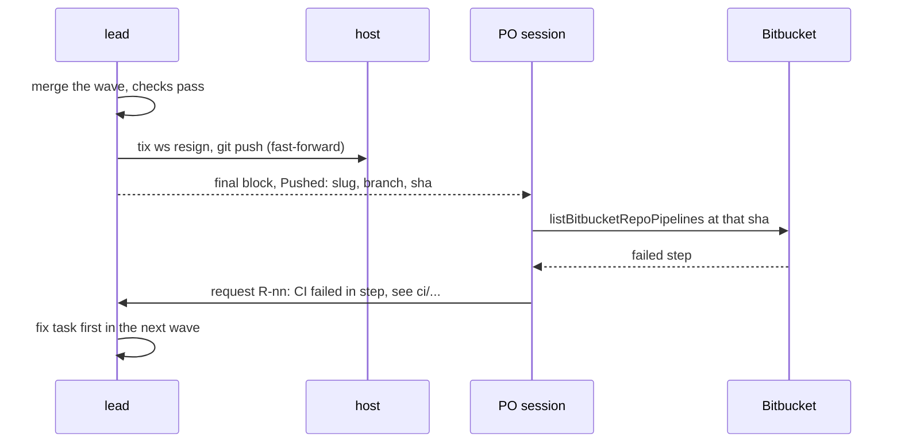
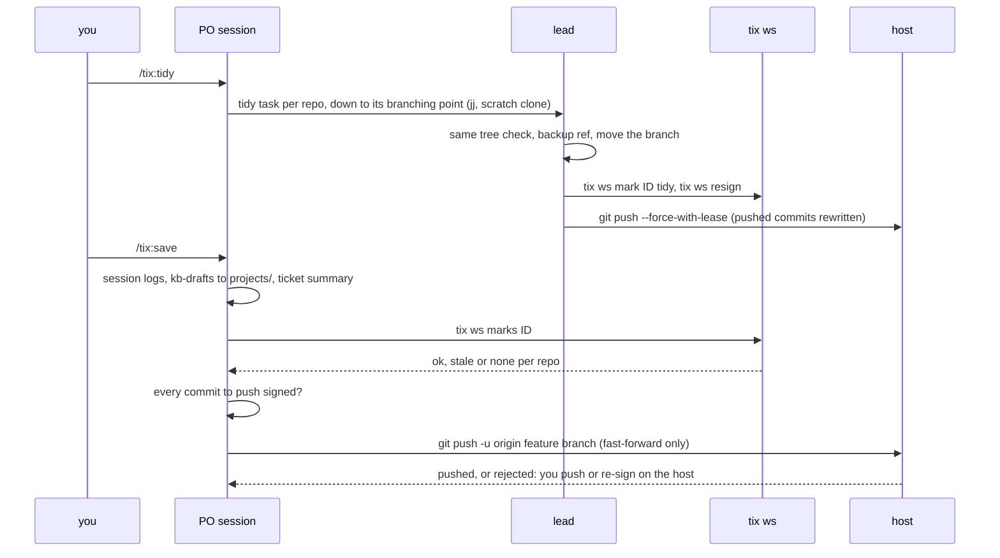

# Pushing and finishing a ticket: push per wave, tidy, save

Sessions commit unsigned on the ticket branches. After every run that merged a wave (or
committed a fix), the lead signs the new commits (`tix ws resign <ID> <slug>`) and pushes
the ticket branch, fast-forward, so the repository's CI scans every wave. The PO follows each
pushed head's pipeline on Bitbucket and sends a failure back to the lead as a request, with an
excerpt of the failing step's log in the ticket's `ci/`; the lead fixes it in its next wave.
A refused signature skips that push until the next run. At the end the order is fixed: tidy,
then `/tix:save`, which pushes what is left. Never a task branch, a branch or tag delete, or a
force push but the lease after a tidy (below).

## Tidy

`/tix:tidy` rewrites the ticket branch's own commits, down to its branching point and pushed
ones included (`git rev-list HEAD --not --exclude=origin/<branch> --remotes`: none
the base or another remote branch has; a commit of another author stops it for your answer),
into coherent ones with
Jujutsu, in a scratch clone `tasks/tidy-<slug>`, never in the ticket worktree. The result must
have exactly the same tree. Before moving the branch, the lead saves the old tip as
`refs/tidy-backup/<branch>` and updates the branch with the old value as a guard. Commits
below the branching point (the base's, another branch's) are never touched; only when you say
so explicitly does it stop earlier (`since <rev>`, or `unpushed`) or go further (`modes.md`).
The lead signs the moved branch (`tix ws resign <ID>`), pushes it with
`--force-with-lease=<branch>:<the old remote sha>` when pushed commits were rewritten (the
host's broker allows that only on your own feature branch), and deletes the scratch clones with `tix ws cleanup <ID>`
(it keeps a clone it cannot show is merged: its bookmark is not yet on the ticket branch, or
the clone has no repo in the workspace, no bookmark or no `.git` of its own; it then exits
nonzero with a warning; `--force` drops it, `--dry-run` only lists). It works in the sandbox, where
`rm -rf` is denied, and touches nothing else under `tasks/`.

## Marks

`tix ws mark <ID> <tidy> [<slug>...]` records, per repo, HEAD, its tree and the time.
A repo with uncommitted changes is skipped with a warning and the command exits 1. A repo
whose worktree is missing is skipped with a warning. `tix ws marks <ID>` prints one line per
repo (`tidy ok|stale|none`): `ok` means the marked tree is the current
one, `stale` means commits came after it, `none` means never marked. It exits 3 unless
every mark is `ok`. Because any later commit makes the mark stale, tidy runs last.
A history rewrite that keeps the tree keeps the mark `ok`, and an entry of another kind in
`workspace.json` (an old docs mark) is ignored. `mark` ends with one line naming every repo it
left unmarked, since the per-repo warnings are easy to miss between the marked lines.

## The push gate

`/tix:save` pushes last, after the logs, kb-drafts, links, the ticket note and the
vault lock release. For each repo of the workspace (`workspace.json`), on its feature
branch only (never a `tasks/*` branch):

- the marks: `tix ws marks <ID>` must exit 0. When some are `stale` or `none`, save asks
  whether to save anyway; if you say yes it still asks again before pushing;
- the signatures: every commit to push (`git log --format=%G? <branch> --not --remotes`)
  must be signed. Sessions commit unsigned; the lead signs at each push and after the
  tidy with `tix ws resign <ID>`. A repo that still has an unsigned commit is not pushed: save asks
  whether to sign now (the same command, which you can also run on the host);
- the push: `git push -u origin <branch>` (or the branch's configured remote). Forced
  only with a lease after a tidy that rewrote pushed commits (the remote tip is an ancestor
  of `refs/tidy-backup/<branch>`). A rejected push (not a fast-forward, or refused by the host's push broker,
  which rejects force pushes and branch or tag deletes and moves) stops that repo, and
  save prints the command to run on the host.

Any other force push, rewriting history below the branching point, and branch or tag
deletes are always your manual steps.
