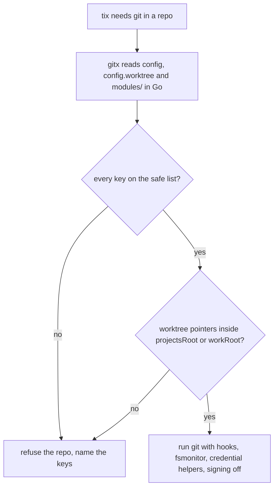

# Git hardening

A ticket session can write the repo directory (`projectsRoot`): it may clone repos and add
worktrees there, given as one `--add-dir`. A hostile or confused write to a clone's
`.git/config` could make a later git run a program. tix therefore reads git configuration
itself before it runs git, in the packages `internal/gitx` and `internal/repo`.

## Layers

- **Sandbox.** The `.git/hooks`, `.git/config` and git pointer files (`.git` files,
  `commondir`, `gitdir`) of clones that already exist are read-only for the session.
- **Config allowlist.** `gitx` parses the repo's own config files before running git and
  refuses the repo when any key is off the safe list, so a planted `core.fsmonitor`,
  `core.sshCommand`, `core.hooksPath`, `core.pager`, an `include`, an external filter or diff
  driver, a `protocol` or a `url.*.insteadOf` rewrite never runs. A symlinked or oversized
  config file is refused. Only `lfs` filters with git-lfs's own commands are allowed.
- **Remotes.** Only `https`, `ssh` and scp-like `user@host:path` URLs; an origin written as
  `host-alias:path` is refused outright.
- **Worktree pointers.** A worktree whose git pointer files lead outside
  `projectsRoot` or `workRoot` is refused. A session can write both folders, so this is a
  layout check, not a proof.
- **Command flags.** git runs with hooks, fsmonitor, `core.gitProxy`, credential helpers
  (`credential.helper=` resets the list, so one from your own config is off for tix too),
  signing, submodule recursion and every protocol but https and ssh off; diffs and logs that
  read patches use `--no-ext-diff --no-textconv`; `GIT_SSH_COMMAND` is yours or plain
  `ssh`; `GIT_DIR`, `GIT_WORK_TREE` and `GIT_CONFIG*` are removed from the environment.
- **Clone.** `tix ws clone` clones with `--no-checkout`, then checks out in the new clone,
  which tix checks like any other. Global and system git config are trusted.

The allowlist and the command flags are independent: each would stop a planted hook or
fsmonitor alone, and `TestHooksAndFsmonitorOff` tests each layer without the other.

## Reading config in Go

A repository's own config can name programs git runs (hooks, filters, transports, pagers).
`gitx.Check` runs no git: it parses the config in Go and refuses the repo before any git
call. A folder in no repository passes.

- The parser (`parseConfig`) follows git's `config.c` byte for byte, because a key read
  differently from git is a key the check never saw. It is stricter than git in a few places
  (a NUL byte, a control character in a subsection, an empty section name) and fails there,
  so ambiguity is always a refusal.
- `TestParseConfigMatchesGit` compares it with `git config --list -z` on seeds and random
  configs (`GITX_DIFF_N` sets the count), and `go test -fuzz FuzzParseConfig ./internal/gitx`
  fuzzes it with git as the oracle. Refusing is always acceptable; reading differently from
  git never is.
- The files read: the common dir's `config` and `config.worktree`, the worktree's own
  `config.worktree`, and every submodule git dir's `config` and `config.worktree` under
  `modules/`, recursively. `config.worktree` is read even without
  `extensions.worktreeConfig`, so whatever git might read is checked.
- A config file that is a symlink, not a regular file, or over 256 KiB (`maxConfigSize`;
  real ones are a few KiB) is refused; a missing one has no keys.
- The `modules/` walk refuses any symlink (git would follow it) and fails closed past
  `maxModuleDepth` or `maxModuleDirs`. A nested submodule's git dir can sit anywhere (its
  name may hold `/`), so every folder is walked except `objects/`, and `refs/` and `logs/`
  only when a git dir sits below them; that search also fails closed (symlink, too deep,
  more than `maxHeadSearch` folders).
- A refusal names at most `maxListed` keys with `file:line` and points at
  `git config --show-origin --list`.

## The allowlist

Keys are matched on their (section, subsection, name) triple in `internal/gitx/allow.go`.
Anything not named is refused, and no allowed key names a program or a place git would run
one from.

- `branch.<name>.*` is allowed except `mergeoptions`: git reads none of the others (tools
  keep metadata there, such as `description`). `pull.rebase` and `branch.<name>.rebase` may be
  `true`, `false` or `merges`, never `interactive`, which opens an editor.
- `filter.lfs.*` only with git-lfs's exact standard smudge, clean and process commands and
  `required=true`; `lfs.<url>.*` only for a URL that passes the URL rule.
- A remote name is `[A-Za-z0-9._-]+` and doesn't start with `-`, so it can never be a URL, a
  path or an option.
- A remote's fetch refspec may only write under `refs/remotes/<remote>/` or fetch tags into
  `refs/tags/`, and a negative one only excludes: anything else could overwrite (and with
  `--prune` delete) local branches.
- The URL rule allows `https://host/...`, `ssh://[user@]host[:port]/...` and scp-like
  `user@host:path`, never a `<transport>::` helper, `file:`, a local path, a host alias
  without `user@`, a leading `-` or a control character.
- The one local-path remote allowed is a ticket workspace's checkout (inside the trusted
  roots, its parent holding `workspace.json`): the origin of the tidy skill's scratch clone,
  where read-only commands such as `tix ws diff-check` run. The file transport stays off, so
  tix never fetches from or pushes to it. Any other local path, a main clone included, is
  refused.
- `core.worktree` is allowed only in a submodule's config under a superproject's
  `.git/modules`, as a relative path inside the superproject's work tree (what git itself
  writes there).

## Pointers and discovery

A session can write a checkout's `.git` file and a main clone's `.git/commondir` and
`.git/worktrees/<n>/{commondir,gitdir}`. Pointed at a folder the session made, they would
have host git load that folder's config, so `internal/gitx/indirect.go` reads them in Go
first.

- Discovery mirrors git's `setup_git_directory_gently_1`, and what git would refuse, tix
  refuses too. It also refuses a symlinked `.git`, a main clone's `.git` with a `commondir`
  file, a `.git` pointer over 4 KiB, a common dir with its own `commondir`, and a git dir that
  isn't one of its common dir's `worktrees/`.
- `TrustRoots` (the vault's `projectsRoot` and `workRoot`): a git dir or common dir reached
  through a pointer must lie inside them. A bare repository, or a `.git` folder that is its own
  common dir, skips that check. Without roots only the layout is checked.

## Every git call

Every tix git call goes through `gitx.Command`, `CommandContext` or `CommandIn`, which
refuse (`cmd.Err`, returned by `Start`) unless the repository passes `Check`.

- The repository is the leading `-C` dir only; `--git-dir` and `--work-tree` are refused. A
  call without `-C` runs in a neutral folder (a clone's checked parent, else the filesystem
  root), so git never discovers a repository from tix's own working directory.
- Callers never set `cmd.Dir` (`CommandIn` runs in a folder). `TestNoDirOnGitxCommands`
  enforces it in every package that imports `gitx`, also for a command kept in a struct
  field, returned by a helper or reassigned.
- `protocol.allow=never` with only https and ssh allowed; `protocol.file` is turned on
  (`localFlags`) only for a call that reads a local repository tix has already checked (a
  shared clone's main clone). `core.sshCommand` is neutralised through `GIT_SSH_COMMAND`.
- The environment also loses `GIT_COMMON_DIR`, `GIT_CONFIG_KEY_*`/`GIT_CONFIG_VALUE_*`,
  `GIT_OBJECT_DIRECTORY` and `GIT_ALTERNATE_OBJECT_DIRECTORIES` (`strippedEnv`): they would
  point git at a repository or config the allowlist never read. tix's own `-c` flags come
  after.
- git never runs inside a submodule's work tree (or an in-tree gitlink repo), whose config
  `Check` never read: `status`, `diff`, `diff-files` and `diff-index` get
  `--ignore-submodules=all` last before any `--`, any other `--ignore-submodules` value is
  refused, and `add`, `describe --dirty`/`--broken`, `commit -a` and `worktree remove`
  without `--force` (which runs status in each submodule) are refused, since tix doesn't use
  them. `PopulatedSubmodule` runs git only in the superproject and counts a failure as a
  submodule.
- A fetch from a named remote gets `--refmap=+refs/heads/*:refs/remotes/<remote>/*` (and that
  refspec when none is given), so it writes only that remote's tracking branches whatever the
  configured refspecs say. A fetch with an option tix doesn't know is left as it is rather
  than guessed at: the option may take a value that would be mistaken for the remote.
- Clones go only through `gitx.Clone` (`clone` with `-C` is refused): `--no-checkout`, known
  flags only, a source that passes the URL rule or is a local repository passing `Check`, and
  a destination whose parent passes `Check`. It runs in that parent with both paths absolute
  and after `--`.
- A shared clone (`git clone --shared`, nothing written to main) gets main's refs and main's
  origin URL, so its pushes reach the real remote. The URL is written with `git config -f` on
  the new clone's file, because a checked call in the clone would refuse its local-path
  origin. Main is checked before every refresh, because git reads main's config over the file
  transport.

`ContainerOverride` is a test-only seam (the CLI tests can't tell a sandbox from the host);
the shipped binary never sets it.

## Clone destinations

`internal/repo` places a main clone exactly at `<provider>/<owner>/<repo>` inside
`projectsRoot` (`CloneDest`, compared lexically). `CheckCloneAncestors` runs before
`MkdirAll` and refuses when the deepest existing part of the parent, symlinks resolved, is
outside the resolved root, since `MkdirAll` would create folders wherever a planted symlink
leads; `CheckCloneParent` then refuses a parent that isn't `<provider>/<owner>` inside the
resolved root. `tix ws clone` checks again after creating the folders, clones into a temporary
name beside the destination (absent before the run, so whatever is there is tix's) and renames
it into place after one more parent check.

## Files tix reads where a session writes

The same rule holds for every file tix reads or moves on the host in a tree a session can
write (worktrees, scratch clones, a dev checkout, specs): open it without following a symlink
and without blocking (a FIFO or device must not hang tix), check it is a regular file on the
open descriptor, and cap its size. Whole trees are walked through an `os.Root`, so a parent
swapped for a symlink mid-walk can't lead outside.

- `tix ws rm`, `gc` and `tix clean` copy ignored files to `.trash/` through an `os.Root` of the
  worktree (`trashFiles`, `copyTree`, `moveTree`); any copy failure stops before anything is
  removed, and a failed cross-filesystem copy removes its partial copy and keeps the source.
  `sameRegularFile` compares files the same way, in chunks.
- `readBranchRef` reads a tidy scratch clone's branch ref in Go: its origin is the worktree's
  local path, which tix's git refuses to run in.
- `tix ws task-clean` acts only on task worktrees of this ticket inside its `tasks/`: their
  paths come from the clone's admin files, which a session can write. It uses `--force` only
  after its own checks and keeps a branch that moved since the tip it checked.
- The spec parser (`spec.readSpec`, `MaxSpecSize`), `spec.ReadTree` and the test-citation
  search of `tix spec check` read only regular files of bounded size.
- The plugin copies (`assets.MaterializeTo`, the dev build's copy at `tix start --dev`) read
  through an `os.Root` at the checkout, so a link swapped in during the copy reaches nothing
  outside it; symlinks and special files are errors.
- The embedding library: a relative `TIX_LIB_PATH` entry is skipped with a warning, because
  `dlopen` from the working directory (a vault or worktree) would run code from there. Building
  the runtime libraries through nix reads the git tree through git, so the repo's config passes
  the allowlist first.

## What stays exposed

- Your own git in a clone made during a session, until the next launch makes its config
  read-only: run it with `-c core.hooksPath=/dev/null` or read `.git/config` first.
- `.lfsconfig` in the work tree can redirect LFS URLs (network only, no program).
- The milliseconds between tix's check and git reading the file.
- A submodule's `core.worktree` pointing inside the work tree, and a local shared-clone
  source that passes the check.
- On Windows, a move inside a worktree is a plain rename after the path check (on Unix it
  goes through `renameat` on the `os.Root`), so a junction swapped in between can still escape.

`tix spec` and `tix teach` sessions also deny the file tools in every repo, so they can't
write a clone at all. Pushes (the lead's after each wave, `/tix:save`'s) go only through the host's push broker, see
[finishing a ticket](finishing-a-ticket.md).
