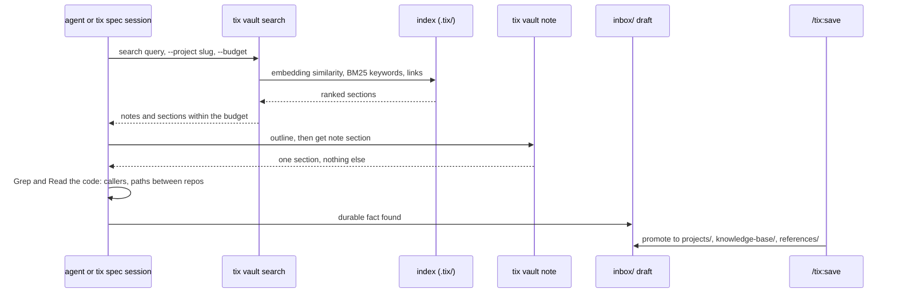

# Knowledge base and vault search

The vault's `projects/` notes describe each repo (by slug), what it depends on, the
features and versions it shipped, and the decisions behind them. Agents look there before
reading code, and `/tix:save` writes new facts back.

## Search

`tix vault search` ranks sections by embedding similarity, BM25 and links. The index lives
in `<vault>/.tix/`, is rebuilt incrementally on search, and is never edited by hand.
The embedding model is fetched once on the host with `tix vault model fetch` into the
cache; a sandbox only reads it. Without the model, search is keyword-only and says so.
`tix vault note outline|get|set-section|append|frontmatter` reads or writes one section and
leaves every other byte as it was.

The vault search commands exit 0 when they succeed, 1 on an error, 2 for a usage error or a
note that is missing or ambiguous, and 3 when a write is refused.

### The index

- Readers take only `index.commit.lock`, which writers hold just around the final renames, so a
  search never sees a half-renamed set and never waits for an embedding run; where the lock
  can't be opened (a read-only vault) it reads without it. An update holds `index.lock` for the
  whole run.
- `meta.json` holds the sha256 of `notes.jsonl`, `chunks.jsonl` and `vectors.f32`, and loading
  verifies them: a set torn by a crash between renames reads as no index and the next update
  rebuilds it. A torn index's vectors are reused as a cache only when the meta's model, sha,
  dimensions, vectors hash and chunk hash all match, so new vectors under an old meta are refused.
- An update failure (read-only vault, full disk) doesn't stop the search: a usable index beats
  none. Notes tix writes itself go through `vindex.Refresh`, which does nothing without an index
  and reports its own errors without failing the command. `tix sync` and the ticket-sync skill
  write notes without listing them, so `tickets/` is snapshotted and the index refreshed for
  exactly the changed files (and the new follow-up note).
- Without an embedding model, an index with vectors keeps them and new chunks get zero rows
  (keyword only) until a model embeds them. Such chunks score BM25 plus the mean semantic score
  of the embedded candidates, scaled by keyword match, so both kinds sit on one scale (contract
  `vault-search-core-v1` v1.4). `tix vault related` with nothing embedded ranks by BM25 alone,
  on purpose.
- A note under a symlinked folder is skipped (compared against the real vault path), while a
  vault reached through a symlink still works. The spec copies and promote staging
  (`specs-base/`, `specs-after/`, `specs-stage/`) are not indexed. The old `.ct` folder moves
  to `.tix`; the index is rebuildable, so a failed move only means a rebuild.
- A repo's spec index keeps the tree hash of its last build, so an unchanged `specs/` costs one
  git call, and a repo with no specs on its default branch has none (a stale one is removed). A
  git tree has no file times, so the blob id's first 63 bits stand in for one, and an edit that
  keeps the size still reads as changed. The file's one final newline, which `gitx.Out` trims,
  is put back so bytes and hash match the file.
- The model lives in `<cache>/models/`, written only by `tix vault model fetch` on the host, one
  fetch at a time (a second would delete the first's partial downloads).
- `internal/chunk` keeps its own copy of `internal/mdsec`'s code-fence rules on purpose: keep the
  two in step.

### Note writes

`tix vault note` writes follow the vault's write rules (`internal/notesec`):

- The rules run first, then the vault lock is taken, the note read again and the edit redone if
  it changed meanwhile, and the file replaced through a temp file and a rename. Symlinks are
  resolved, so the rules see where the write lands, and a note resolving outside the vault is
  refused.
- The rules compare the write's actual change, not the section it names (setting an H1 that has
  subsections names only the H1). The match on the source block's markers is looser than
  `tix sync`'s on purpose: it over-protects. Content with a heading at or above the section's
  level would re-parent what follows, and one titled like a content section would add a second:
  both are refused. Frontmatter keys must be plain YAML keys, so no newline, colon or padding is
  smuggled in. A note with more than one source key or unparsable frontmatter is not manual.
- A task note's missing `## Report` is created on write, so a task file written without the
  template heading still takes its agent's report. The report goes to the workspace of the task
  file's ticket, not the shell's folder: a task agent's working directory is reset between calls.
- Headings inside an HTML comment left open on a line are not sections; code spans are blanked
  first, so a literal `<!--` in one opens nothing. `Find` prefers an exact whole-title match over
  reading `A > B` as a path.

## Links

Wikilinks resolve as in Obsidian (`internal/links`): a target without `/` matches by file name
(case-insensitive, `.md` implied for notes), one with `/` matches the end of the vault-relative
path; links in code are ignored and dot-folders (`.obsidian`, `.trash`) skipped.

- A move is refused when another file already has the destination's name, since bare-name links
  would become ambiguous. A rename also rewrites bare-name links, only when the old name meant
  just this file.
- A folder move rewrites links before the files move, and moves the folder's own note after all
  others, so a run after an interruption finds the files whose new path a link already names and
  completes the move. It fails before changing anything when a destination exists.
- When a cleaned ticket's links become links to its source page, a heading or block link (which
  can't point at a remote page) and an embed degrade to plain links. A frontmatter link is
  rewritten only when it is quoted on its own or a field's whole value; others are reported.

## Without a ticket

`tix spec "<question>"` opens a session with the vault and every main clone read-only. It
answers from the vault first, then the code.
`tix spec repo checkout <repo> <ref>` makes an exploration clone to build and test in; it is
never committed. A durable fact becomes a draft in `inbox/`; an issue worth following up
becomes a manual ticket with `tix new`. `tix claude` gives a plain repo session the same
skills.

A spec session may lack git credentials, so `tix spec` fetches every main clone's remote branches
before it starts, and its git runs never prompt (they fail fast). Exploration clones are the
session's own; main clones stay untouched and nothing is committed or pushed. A clone left by a
failed checkout is removed, so an unrecorded clone with nothing checked out doesn't block the
next one.

## Relations between projects

A project lists what it needs in `depends-on`; projects sharing flows can join a group
note. `tix vault groups` prints the clusters and `--check` validates the links.
