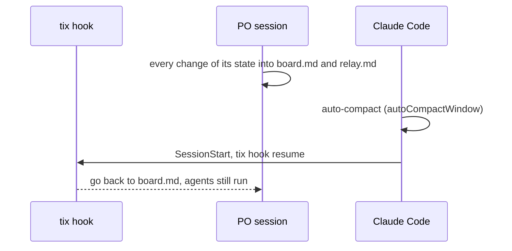

# Session upkeep

Sessions run in the foreground of the terminal that started them (one ticket per
terminal; `tix status` and the session PID records cover several). Three hooks keep a long
PO session usable, and one keeps comments out of edits. They are `tix hook` subcommands wired by the plugin.

## Context reminders

`tix hook context` reads the last reply's token usage from the transcript and, once each at
150k, 200k and 250k, shows a one-line warning suggesting `/compact`; past the last it repeats on
every message. `TIX_CONTEXT_WARN` sets the thresholds. It is silent when it can't
read the size, in a ticket workspace (below), and never fails.

## Compaction

A ticket session's PO never holds state only in chat: every spawn, completion notice, user
entry and pushed head goes into `board.md`'s `po:` block or `relay.md` in the same step. So the
session compacts by itself whenever Claude Code's auto-compact (`autoCompactWindow`) decides
to, with no checkpoint and nothing for you to type, and the lead and workers keep running
through it. After a compaction (or a `/clear` you type) the resume hook points the PO back at
its board and says the agents are still running; each clear or compact is logged in
`<workspace>/.session-log` with the session id, marked `CHANGED` when it differs.

## Notifications

`tix hook notify` pings for `Notification` events (`permission_prompt`, `elicitation_dialog`,
`idle_prompt`) only when you are needed, once until you answer (a per-session flag cleared
by `UserPromptSubmit`), critical and kept on screen. No `idle_prompt` ping while the
board lists running agents. `TIX_NOTIFY=0` turns it off.
Notifications are best effort: with no notifier, or when it fails, nothing is said (Windows
has none yet).

## Session state

- The hooks follow every tool call for the `working` state, so `tix hook` leaves
  `.agent-state` alone when nothing changes. They write `.agent-state.tmp` and rename it over
  the file, so every write is a new file; `tix status` detects one by file identity, mtime and
  size, even when size and mtime stay the same.
- A session runs when one of its recorded processes is alive on this host; when all are provably
  dead it doesn't, whatever `.agent-state` says. Only when no record can be checked (none,
  another host, a container, an OS that can't tell) does the hooks' last state count, if it isn't
  `exited` and is under a day old. A process is its PID plus start time (and boot id on Linux),
  so a reused PID never counts, and a zombie counts as not running.
- tix records itself just before it execs into the agent: the identity survives the exec. Where
  the OS can't exec, the session runs as a child with tix's terminal.
- A prompt that reaches end of input aborts tix, since it would otherwise take its default or
  ask forever. A headless run keeps draining the agent's output even after it stopped reading,
  or the agent would block on a full pipe.

## tix status --watch

- Signals are handled before the alternate screen is entered, so none kills tix while it is
  there. Refreshes never overlap (one goroutine, a result channel of one, so a refresh abandoned
  at exit never blocks), and the change baseline is taken just before each refresh, so a change
  during one starts the next right after it. A panic in a refresh is recovered in its goroutine.
- Lines past the height become `... N more` and the first lines stay, because what needs you
  sorts first; a size below 1 means unknown (80x24). Control characters become spaces, so a
  waiting reason can't move the cursor.

## The main session's service

`tix main` starts its host service before it execs into the agent; the service exits when its
parent does. Its socket folder is private to you and holds nothing else, and the record of the
herdr workspaces it started lives outside it, on the host only, so a session can't add one of
your panes to it. Every request names a ticket of the vault and the service finds that session
itself (the herdr agent whose foreground folder is the ticket's workspace), so main never reaches
another pane or answers an agent's approval or question.

The waker prompts main only when something it acts on happened, only while main is idle, and no
more often than its debounce, because each pass is a turn of main's that herdr notifies you of.
It polls herdr, the vault and the pull requests itself, so it needs no turn of main's and
survives main's restarts. Of a pull request's state, main acts on conflicts and a branch too far
behind only: approvals are yours and builds are in the CI field. Task worktrees and tidy clones
are removed after a session ends, since inside the sandbox they stay busy and pile up; without
`--force` both keep anything unmerged.

## Comment check

`tix hook comment-check` runs after every Edit, MultiEdit and Write in a ticket or spec session
(the nearest `workspace.json` above the cwd; elsewhere it does nothing). It takes the
whole-line comments the edit added, with the matcher `tix ws diff-check` uses for
`note comment-added`, and tells the session to remove them unless they are a kind
`tix:practices` keeps. A Write is compared with the file at HEAD; a comment moved within an
edit isn't new. The edit stays applied: the hook's reason is feedback, so a kept kind (a
platform quirk) is left alone. Catching a comment at the edit costs one line of context,
where the merge-time note costs a reword of the branch. Claude Code only: kiro's hooks can't
reply to the agent, so kiro sessions rely on the diff-check note and the reviews.

`--anywhere` turns it around for the user's own Claude Code settings: every session outside a
tix workspace is checked (inside one, the plugin's hook already runs). `TIX_COMMENT_CHECK=0`
turns either off, e.g. in the `env` of a repo's `.claude/settings.json` when its house style
has comments.
