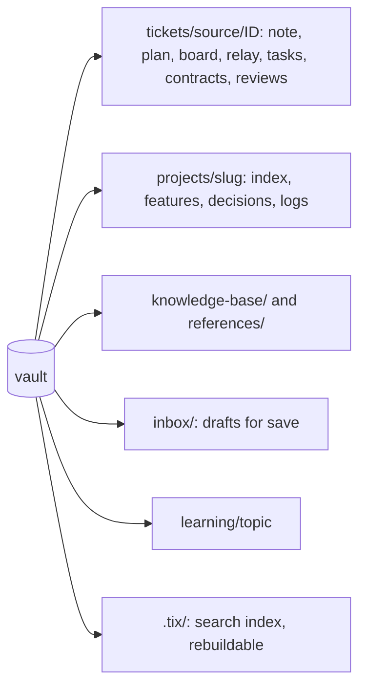
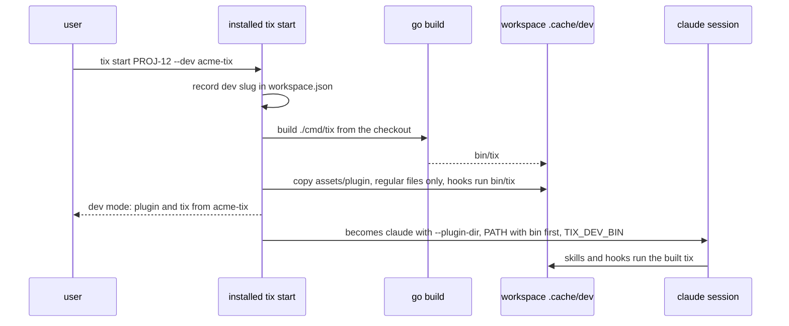

# Workspaces and the vault

## The vault

The vault is an Obsidian folder `tix vault init` scaffolds from `assets/vault-scaffold/`
(its `AGENTS.md` is the rulebook agents follow inside it). `tix vault update` keeps shipped
files current using the hash history in `assets/scaffold-history.json`, so an unedited old
copy is replaced and an edited one is kept. Per-vault settings (`workRoot`,
`projectsRoot`, `toolVersions`) live in `.workflow.json`; ticket sources in
`tickets/.sources.json`. A ticket's folder is `tickets/<source>/<ID>/`, `<source>` being
its source's key there (`jira`, `manual`, ...) and its note's `source:`; `tix vault update`
moves the folders of an older vault (`tickets/<ID>/`) under their source.

- `workRoot` may not lie inside `projectsRoot` (`vault.Validate`): the deny rules of `tix spec`
  and `tix teach` assume repos sit exactly three levels under `projectsRoot`, so a nested
  `workRoot` would deny the sessions their own exploration clones.
- A source key that looks like a ticket ID is invalid (`note.ValidSource`), so the old and new
  folder layouts never mix up.
- The next manual ticket number is past every ticket folder's, under any source or the old
  layout, and the archived ones'; the folder is made with an atomic `mkdir`, so two runs never
  take the same ID.
- Note readers work on BOM-less LF text, so frontmatter and markers are found in Windows
  checkouts too; edits write LF back. Hand-written unquoted wikilinks (`key: [[a]], [[b]]`)
  are read as links, not nested lists.
- A follow-up note is `inbox/<yyyy-MM-dd-HHmm>-<command>-follow-ups.md` (`-2`, `-3` for a
  second one in the same minute); nothing is written without tasks or outside an Obsidian vault.

Only `/tix:save` writes the shared notes (`projects/`, `knowledge-base/`,
`references/`). Other sessions write their ticket folder and leave drafts in `kb-drafts/`
or `inbox/`.

### Scaffold and migrations

- A shipped file's state (missing, up to date, stale, edited) comes from a normalized hash
  (`scaffold.Key`) checked against the built-in history. A copy that matches the vault's
  `.scaffold.json` but is unknown to this tix came from a newer tix and is kept, never
  downgraded; so is a whole record with a higher format. An invalid record is rewritten only
  when files are written anyway.
- Each `tix vault update` run takes the vault lock with an owner of its own, because the lock
  lets its holder straight back in. Obsidian doesn't honour the lock, so a retired view is
  checked again just before it is deleted. Writes go through a dot-file with a unique name and a
  rename, so neither Obsidian nor a concurrent run sees half a file.
- The Tasks plugin: download and file-format problems are warnings (the next run tries again),
  only unexpected local I/O fails. Files are downloaded and sha256-checked first, then a staged
  copy is renamed into place, so a failure leaves the folder as it was; the temp folders sit in
  `.obsidian/` outside `plugins/`, so Obsidian never takes one for a plugin.
- One lock covers scaffold and migration; a failed layout move leaves the checklist migration
  for the next run. The converters (`internal/ticketmigrate`) are pure and idempotent, never
  guess (an unparseable file stays whole, with one problem per line), keep line endings, the
  final newline and a BOM, and never convert inside HTML comments or code fences. A converted
  file is read again just before the rename and skipped with a warning if it changed.
- Folder moves fail as a whole when one destination is taken, so those folders are set aside
  first; the note moves last, so an interrupted run is finished by the next.

## A ticket workspace

`tix ws add <ID> <repo> --base <branch> [--desc <d>] [--version <v>] [--branch <b>]`
creates the ticket's worktree of a repo at `<workRoot>/<ID>/<slug>` and records the repo,
base, branch and target version in `workspace.json`. The branch is
`feature/<ID>[-<description>]` for a synced ticket and `feature/<description>` for a manual
one. `--branch` checks out an existing branch instead, for example an open PR's source. A
manual ticket's branch that another workspace has already recorded is refused, so two
tickets never share a branch.

Each `tix start`, `tix ws add`, `tix spec` and `tix teach` writes `<workRoot>/<ID>/.tool-versions`
(golang from the repos' `go.mod`, python and others from `toolVersions` in
`.workflow.json`; a tool with no installed version gets a warning and is left out). The
workspace's `CLAUDE.md` is regenerated on every start and names the vault, the repos and
the Git rules. tix owns that `.tool-versions`: it overwrites any existing one when something
resolves, removes a stale one that starts with its header when nothing does, and otherwise
leaves a file of yours alone.

`workspace.json` is written by sessions too, so `workspace.Read` drops repos recorded outside
the workspace folder with a warning (commands remove, rebase and fetch into those paths), and
`tix status --watch` shows the warning in its frame. Every change runs under a lock on the
file's generic map, so parallel writers (subagents adding worktrees) keep each other's fields.
Live sessions are in `.sessions.json`, separate so `workspace.json`'s format stays stable, and a
list since a spec workspace hosts several. A session is recorded just before tix execs into the
agent (the new process keeps PID and start time), and `ClaimSession` checks and records under one
lock, so two racing `tix start`s can't both get a workspace; `tix start` also checks again
under that lock after its fetch. A missing `claude` fails before anything is said or recorded.
A `tix teach` workspace has no repos, is hidden from `tix status` and `tix ws`, and has one
session per topic, since the teach skill writes its folder directly.

Each session's `.claude/settings.json` denies writes to tix's cache (`//` marks an absolute
path in a Claude rule) and, for ticket sessions, allows the repo directory, since they clone and
add worktrees. `$TIX_SESSION_SETTINGS` merges in (objects merge, arrays are joined). `PATH` is
never set there: a dev workspace's built tix goes first through `launcher.Session`'s
`PathFirst`. Marking a workspace trusted in Claude Code keeps its lock file afterwards (removing
it would let a waiting writer and a new one both hold the lock) and keeps numbers exactly as
written.

`tix ws run` and `tix ws browse` enter the pod's network namespace as root of podman's user
namespace, bind-mount the pod's `resolv.conf` in a mount namespace of their own, then run the
command as you, with uid and gid mapped back. The browser gets a profile of the ticket's own:
a server in the sandbox would otherwise see your localhost cookies.

Task worktrees live under `<ID>/tasks/<slug>-<n>`, are created and removed by the lead,
and are merged into the ticket branch. `tix ws rm` removes a workspace (refusing dirty or
unpushed work, and ignored files such as a changed `.env` unless `--drop-ignored`; commit, push or stash the rest: there is no force), `tix ws gc` and `tix clean` free disk, moving ignored files of yours to the vault's `.trash/<ID>-ignored-files/` instead of deleting them, `tix ws fetch` refreshes the main
clones. A session can clone a repo it needs into the projects root (`tix ws clone`, never
twice), then make its worktree with `tix ws add`; there are no other copies of a repo. A session can write the repo directory (`projectsRoot`): it may clone repos and add worktrees there. The sandbox keeps the `.git/hooks`, `.git/config` and git pointer files (`.git` files, `commondir`, `gitdir`) of clones that already exist read-only. tix's own git (`gitx`) first reads the repo's own config files in Go (`config`, `config.worktree`, and the submodules' under `modules/`) and refuses the repo when any key is off a safe list, so a planted `core.fsmonitor`, `core.sshCommand`, `core.hooksPath`, `core.pager`, an `include`, an external filter or diff driver, a `protocol` or `url.*.insteadOf` rewrite and the like never run; it refuses a symlinked or oversized config file and a worktree whose git pointer files lead outside `projectsRoot`/`workRoot` (a layout check, not proof: a session can write both folders). Only `https`, `ssh` and scp-like `user@host:path` URLs are allowed for remotes, and only `lfs` filters with git-lfs's own commands. On top of that git runs with hooks, fsmonitor, `core.gitProxy`, credential helpers (`credential.helper=` resets the list, so one from your own git config is off for tix too), signing, submodule recursion and every protocol but https and ssh off, `--no-ext-diff --no-textconv` on diffs and logs that read patches, `GIT_SSH_COMMAND` yours or plain `ssh`, and `GIT_DIR`, `GIT_WORK_TREE` and `GIT_CONFIG*` removed from the environment. `tix ws clone` clones with `--no-checkout`, then checks out in the new clone, which tix checks like any other. The allowlist reads your global and system config as trusted. Not covered: your own git in a clone made during a session, whose config the sandbox doesn't make read-only until the next launch (run it with `-c core.hooksPath=/dev/null` or read `.git/config` first); `.lfsconfig` in the work tree, which can redirect LFS URLs (network only, no program); the milliseconds between tix's check and git reading the file; a submodule's `core.worktree` pointing inside the work tree; a local shared-clone source that passes the check; and an origin written as a `host-alias:path` (refused outright, not rewritten). `tix ws refresh <ID>` rewrites the workspace's `CLAUDE.md` from the vault
exactly as `tix start` does and touches nothing else; the kickoff runs it once `board.md`
names the ticket's commit style, so the Git rules in `CLAUDE.md` are current. The tidy skill's scratch clones (`tasks/tidy-<slug>`) are removed with
`tix ws tidy-clean <ID>`.

### Dev workspaces

A ticket that changes tix itself would otherwise run its agents on the installed
plugin and `tix`, so its own new rules never apply while it is worked. `tix start <ID> --dev
<slug>` records `"dev": {"slug": "<slug>"}` in `workspace.json` (omitted when off; `--dev
none` clears it), where `<slug>` is a repo of the workspace with `cmd/tix` and
`assets/plugin`. Every start of a dev workspace then builds `tix` from that checkout into
`.cache/dev/bin` (the workspace's Go env; a failed build fails the start, nothing falls
back), copies the checkout's `assets/plugin` to `.cache/dev/plugin` with its hooks running
the built `tix` by path, and gives the sessions that plugin, `.cache/dev/bin` prepended to
and the `PATH` they start with (expanded where `claude` starts, not a copy of `tix start`'s
own).
`tix start` prints `dev mode: plugin and tix from <slug> (<short HEAD>[-dirty])`. The
sessions also get `TIX_DEV_BIN=<workspace>/.cache/dev/bin`: a sandbox or
container wrapping `claude` that sets its own `PATH` prepends it (the path is in the
workspace, so it exists inside too); otherwise skills and hooks run the installed `tix`.

The installed `tix` never runs the built binary or other checkout code outside a session:
it only builds (the go.mod toolchain and module downloads still run on the host) and copies
regular files and dirs (a symlink or other special file in `assets/plugin`, or
`assets/plugin` itself a link, fails the start with an error naming it), and the copy
refuses to replace a `.cache/dev/plugin` that isn't a plugin. A running
session keeps the build it started with: `tix start` refuses a ticket whose session runs, so
every start builds and copies afresh. `tix clean --save` ignores `dev`: its unattended `/tix:save`
runs on the installed plugin and `tix`. An unknown `<slug>` fails with `<slug> is not a repo
of <ID>'s workspace (tix ws add first)`.

## Repo slugs

A repo is named `<provider>-<owner>-<repo>`, from its origin URL. The slug names the vault
project folder, the worktree folder and version tags. `tix layout` moves
main clones to `<projectsRoot>/<provider>/<owner>/<repo>`.

`repo.RemoteIdentity` reads the owner as the project key, upper-cased, on Bitbucket Server or
Data Center (`/scm/<key>/<repo>`, ssh `:7999/<key>/<repo>`), the workspace on Bitbucket Cloud,
the user or org on GitHub, and the group on GitLab (subgroups joined with `-`); any other host
gives its name kebab-cased and the path before the repo. A URL that isn't hosted has no slug.

`tix layout` moves in two phases, staging outside the tree deepest first, then placing the
shallowest destination first, because a repo can sit where another repo's provider or owner
folder must go (`~/Projects/bitbucket`). A repo with linked worktrees stays, and so does every
repo around it.

## Cleanup

`tix clean` removes a closed ticket's workspace once its work is saved and pushed, then
moves a synced ticket's folder to `.trash/` and a manual one's to `archive/tickets/<source>/<ID>/`.

- Worktrees count when deciding a ticket is safe to clean: `tix ws rm` doesn't check them, the
  branch stays in the main clone, but a never-pushed branch is easily lost. A git that fails
  counts as unsafe (see [when removal loses work](workspace-commands.md#when-removal-loses-work)).
- A lead goes only with or after every ticket it covers: their notes still get its `/tix:save`
  and their work is in its workspace. Covered tickets go first, so a lead's files their notes
  embed then count as theirs. Files kept when a folder goes are those a note outside it links,
  closed over links between the folder's files; the folder's own note is never kept, links to it
  are rewritten instead.
- `--save` runs without the vault lock, since `/tix:save` takes it itself. The search index is
  refreshed only after a run that wrote something, for the whole vault when an item failed after
  writing.
