# Workspace commands: tix ws

`tix ws` manages the git worktrees of ticket workspaces. A workspace is
`<workRoot>/<ID>/` with one worktree per repo (branched from the repo's base), task
worktrees under `tasks/`, `workspace.json` and `.cache/`. The layout is in
[workspaces and the vault](workspace-and-vault.md); the hardening git runs under is in
[git hardening](git-hardening.md).

```mermaid
flowchart LR
  clone["tix ws clone: main clone"] --> add["tix ws add: worktree and branch"]
  add --> work["sessions commit on the ticket branch"]
  work --> check["tix ws diff-check, tix ws sec-check, tix ws diff"]
  check --> marks["tix ws mark and marks: tidy"]
  marks --> save["/tix:save pushes"]
  save --> gc["tix ws gc or tix clean: free disk"]
  gc --> rm["tix ws rm: worktrees go, branches stay"]
```

| Command | Does |
|---|---|
| `tix ws repos` | list the main clones: slug and `<provider>/<owner>/<repo>` |
| `tix ws clone <provider>/<owner>/<repo>` or `--url <git url>` | clone into `<projectsRoot>/<provider>/<owner>/<repo>` |
| `tix ws add <ID> <repo> --base <branch> ...` | create or reuse the ticket's worktree |
| `tix ws ls [<ID>]` | worktrees: branch, uncommitted changes, ahead/behind the base |
| `tix ws diff <ID> [--stat] [--viewer <name>]` | everything changed on the ticket's branches since they left the base; in a terminal diffnav (a file tree over delta) on all the ticket's repos at once, untracked files as new; piped or `--stat`, git's diff per repo. `--viewer` or `TIX_DIFF_VIEWER` picks `diffnav` or `git`; a viewer is one `diffview.Viewer` in `internal/diffview` |
| `tix ws fetch [--max-age 10m] [<repo>...]` | fetch origin in the main clones (and pass refs to the shared clones of those repos); `--max-age` skips a clone fetched more recently. `tix start` fetches only the ticket's repos (its workspace's, or its note's `projects:`, else every clone), skipping any fetched in the last 10 minutes |
| `tix ws refresh <ID>` | rewrite the workspace's `CLAUDE.md` from the vault (commit style, repos) |
| `tix ws sec-check [-C <dir>] [--all] <since>` | the security scanners (gitleaks, gosec, govulncheck, npm audit, OSV.dev for Maven and Gradle) on a checkout: findings of the commits since `<since>` are `new` (exit 3 when one blocks), with `--all` the `legacy` ones too; how the workflow uses it: the `practices` skill's `security.md` |
| `tix ws mark`, `marks` | the tidy mark, see [finishing a ticket](finishing-a-ticket.md) |
| `tix ws tidy-clean <ID>` | remove tidy's scratch clones under `tasks/` |
| `tix ws task-clean <ID>` | on the host: remove merged task worktrees under `tasks/` and their branches (the sandbox can't when a worktree existed at its start); `tix start` runs it before each session |
| `tix ws cleanup <ID>` | remove what is spent and say what was kept: tidy clones whose result is on the branch, `refs/tidy-backup/*` of pushed branches, merged task worktrees (on the host) |
| `tix ws resign <ID> [<slug>...]` | sign the unpushed commits of the ticket branch (same trees, authors, dates and messages); `--dry-run` lists the unsigned ones. Sessions commit unsigned; the lead runs it before each push and after the tidy |
| `tix ws env [<ID>]` | print the workspace's Go cache variables as `export` lines, for a shell that didn't inherit them (`eval "$(tix ws env)"`) |
| `tix board set <ID> <NN> <status> [--note <text>] [--from <status>]` | set a task line of `board.md` under a lock (box, status word and date mark) |
| `tix board wave <ID> [--wave N]` | print a wave's task lines, and which are finished or open |
| `tix ws diff-check` | flag binary, large and vault-only-ID changes in a range |
| `tix ws rm <ID>`, `tix ws gc` | remove a workspace, free disk |

## add

`tix ws add <ID> <repo> --base <branch> [--desc <text>] [--version <target>] [--branch <existing>]`
branches from `origin/<base>` (the local base when there is no such remote branch) and
reuses the branch if it exists. The branch is `feature/<ID>[-<description>]` for a synced
ticket and `feature/<description>` for a manual one (so `--desc` or `--branch` is
required there); a branch another workspace already records for that repo is refused.
`--branch` checks out an existing branch instead (an open PR's source) and `--base` is
then what it merges into. It copies untracked files matching the main clone's
`.worktreeinclude` (such as `.env`) and records repo, base, branch and target version in `workspace.json`. It only creates
worktrees; it no longer falls back to a shared clone (older workspaces' shared clones still
work). A session clones a new repo with `tix ws clone` first.

- A workspace repo is always a worktree of the one main clone, never a second copy.
  `TIX_WS_SHARED_CLONE=1` makes a shared clone instead, for tests; older workspaces may still
  hold shared clones (mode `clone`).
- `add` sets no upstream: that would write the main clone's `.git/config`, which sandboxes
  mount read-only. `push.autoSetupRemote` covers the first push.
- Its fetch is best effort: a sandboxed session may have no git credentials, so it works on
  the host only (`tix start` fetches before launching).
- The base a branch is compared with (`gitx.BaseRef`) is `origin/<base>` if present, else the
  local `<base>`, else the first other remote's `<base>` by name (a clone whose remote isn't
  `origin`), else the plain name.

## rm

`tix ws rm <ID> [--drop-ignored]` removes the worktrees and workspace files; branches are
kept. Every guard is checked and a refusal lists all that apply: uncommitted changes
(modified and untracked), a checked-out submodule, ignored files (`.env`, local configs)
that removal would delete and, for an older shared clone, commits not on origin.
`--drop-ignored` lifts only the ignored-files stop. Nothing else is skippable: commit,
push or stash the work, or remove the directory by hand.

tix decides on submodules with its own status, which doesn't enter them: plain
`git worktree remove` would run status in each one. A tree with a checked-out submodule is
kept, since the submodule's changes live under the git dir's `modules/` and would go with it.

### When removal loses work

The guards of `rm`, `gc` and `tix clean` share one reading of "work would be lost", and
every unclear answer is the safe one:

- `gitx.Dirty`: a git that fails counts as dirty. Status runs with `--no-optional-locks` (it
  never writes the index, so `tix clean --dry-run` changes nothing) and
  `--untracked-files=normal` (`status.showUntrackedFiles` can't hide untracked files).
- `gitx.Lost`: commits on HEAD that no remote has lose work unless `MergedInto(origin/<base>)`
  says their changes are already there. For a shared clone (its branches live only in it) a
  stash or commits on other branches count too; a worktree's stash lives in its main clone, so
  `UnpushedHead` ignores it. An error means "can't tell" and keeps the tree.
- `gitx.MergedInto` only reads: HEAD counts as merged if the files it changed read the same in
  the base, or every commit's patch is in the base per `git cherry` (trusted only on a branch
  without merge commits), or HEAD's whole change equals one base commit's patch-id (a squash
  merge after the base moved on). A conflicted or edited merge reads as not merged.
- Ignored files are copied to `.trash/` before any nested repository moves, so a failed copy
  leaves the worktree as it was. The trash takes a few small files (`.env`, local configs),
  never build output or dependency trees (`bulkDirs` and per-file, total, count and
  per-folder caps). A clean clone under a build or dependency folder (`node_modules/<pkg>`)
  has its history on a remote and goes with the worktree; a repo git can't vouch for is kept.

## gc

`tix ws gc [--days N] [--dry-run]` (host only, refused inside a container) frees disk:

- workspaces of tickets whose note says `done` or `closed` and that are idle for N days
  (default 14), through the same guards as `rm`. A workspace kept for dirty or unpushed
  work is listed in a follow-up note in the vault's `inbox/`;
- the `.cache` of sessions that aren't running (Go's caches refill when next used);
- idle `tix spec` exploration clones.

A session counts as running when its process (`tix start`, `tix teach`, `tix spec`) is alive on
this host, else when its hook state (`.agent-state`) is under a day old and not exited.
Inside a container tix sees none of the recorded processes and would clean up live
workspaces, which is why `gc` and `tix clean` refuse to run there. Workspaces kept although
their ticket is finished are listed per vault, so each follow-up note lands in its own vault's
inbox.
Ignored files of yours move to the vault's `.trash/<ID>-ignored-files/` instead of being
deleted. `tix clean` frees the closed tickets' workspaces the same way, after they are saved.

## diff-check

`tix ws diff-check [-C <dir>] [--max-size 1M] [--ticket <ID>] <rev-range>` walks the commits of
a range. Flagged lines make exit 3; notes never do; a usage error, a non-checkout or a bad
range exit 1.

| Line | Meaning |
|---|---|
| `binary`, `large`, `binary,large`, size, short sha, path | a file a commit adds or modifies that git treats as binary or whose blob is over the limit |
| `vault-id`, ID, short sha, path or `:commit-message` | with `--ticket`, the ticket's own vault-only IDs (the key, relay `R-nn`, backlog `B-nn`, review finding IDs) that a commit introduces; a line kept from the base passes |
| `wave-test`, test name, short sha, path | with `--ticket`, a test name built from one of the ticket's waves (`TestW116Foo`, `test_w3_bar`) that a commit adds to a test file; a name kept from the base passes |
| `spec-id`, REQ-ID, short sha, spec file | for `A..B` or `A...B`, a requirement ID that B adds but A already defines, or that B defines twice |
| `note test-changed <name> <sha> <path>` | a commit changes or removes a Go `Test*`, `Benchmark*`, `Fuzz*` or `Example*` func that its first parent had; name `-` stands for a `testdata/**/*.txtar` file or a test file that couldn't be parsed |
| `note comment-added <lines> <sha> <path>` | a commit adds whole-line comments to a source in a `//` language (Go, JS/TS, Dart, Rust, Java, Kotlin, Swift, C, C#) or a `#` language (shell, Python, Ruby, Nix, YAML, TOML, Terraform, Makefile, Dockerfile) outside `testdata/`, `vendor/` and `node_modules/`; `<lines>` counts the distinct comment lines beyond those it removes. Directives (`//go:`, `//line`, `+build`, `#!`, `# -*-`, `# syntax=`, `# shellcheck shell=`), legal headers, generated-code markers, `prettier-ignore`, `/// <reference>` and lines with a link are not counted; lint suppressions are |
| `note commit-style <style> <sha> :commit-message` | with `--ticket`: a subject that misses the ticket's commit style (`<ID>: summary` for `ticket`, `type(scope): summary` for `conventional`) |

- A vault ID matches as a whole word (IDs start and end with a word character), the
  alternation tries longer IDs first so a prefix never shadows one, and an ID counts as
  introduced where a commit adds it more often than it removes it, so a moved line or renamed
  file keeps it. A type change (`T` in `--name-status`) is read as two diff blocks.
- The commit-style check takes the separator after the ticket ID from the majority of the
  last 200 non-merge subjects on the range's left side.
- Lint suppressions are counted as comments: each needs a reason a reviewer can check.
- For `spec-id`, unrelated histories share nothing, so every ID at the end is new.

The usage by agents is in [the ticket workflow](ticket-workflow.md#checking-a-range-for-binary-and-large-files).
